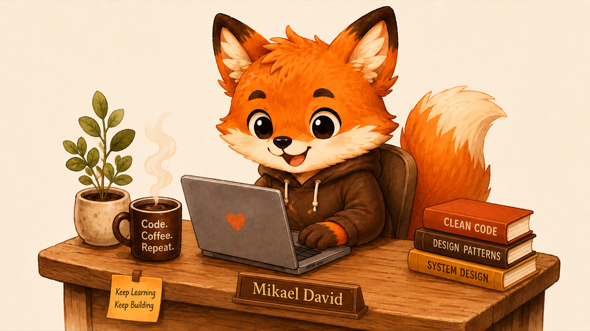

### Brazilian fullstack dev — building products solo, one cup at a time.  

---

##  What I build

I ship products end to end, from the database to the App Store. Live sites and details: **[mikaeldavid.dev](https://mikaeldavid.dev)**

| Product | What it does | Stack |
|---|---|---|
|  **[Curral Tech](https://curraltech.com)** | Livestock management platform I built end to end: offline-first app, API, admin panel and RFID over Bluetooth | Flutter · Node.js · PostgreSQL |
|  **[OddNow](https://oddnow.mikaeldavid.dev)** | Real-time odds comparison SaaS, live with subscriptions | React · NestJS · PostgreSQL · Socket.IO |
|  **[Hatchling](https://github.com/MikaelDDavidd/hatchling)** | Coding agents in the macOS notch, with an iPhone companion (open source) | Swift · SwiftUI |
|  **[bottleneck](https://github.com/MikaelDDavidd/bottleneck)** | Claude Code skill that finds the real performance bottleneck of your app (open source) | Agent skills · Python · k6 |
|  **[Rango](https://rango-receitas.netlify.app)** | AI recipe app on the App Store and Google Play | Flutter |
|  **[Repooor](https://github.com/MikaelDDavidd/repooor)** | Pantry restocking app that reads NFC-e receipts, offline-first with sync (open source) | Flutter · Riverpod |
|  **[Wardline](https://wardline.mikaeldavid.dev)** | League of Legends match assistant, in development | Tauri · React · Rust |
|  **[Memes Pack BR](https://memes.mikaeldavid.dev)** | WhatsApp sticker and meme audio app, 800K+ downloads | Flutter · NestJS |

---

##  Tech I work with

<table align="center">
  <tr>
    <td align="center" valign="top"><b>Mobile</b></td>
    <td align="center" valign="top"><b>Frontend</b></td>
    <td align="center" valign="top"><b>Backend</b></td>
    <td align="center" valign="top"><b>Data</b></td>
    <td align="center" valign="top"><b>DevOps</b></td>
  </tr>
  <tr>
    <td align="center" valign="top">
      
      
      
    </td>
    <td align="center" valign="top">
      
      
      
      
    </td>
    <td align="center" valign="top">
      
      
      
      
    </td>
    <td align="center" valign="top">
      
      
      
      
    </td>
    <td align="center" valign="top">
      
      
      
      
    </td>
  </tr>
</table>

---

##  GitHub stats

  

  

  

<picture>
  <source media="(prefers-color-scheme: dark)" srcset="https://cdn.jsdelivr.net/gh/MikaelDDavidd/MikaelDDavidd@output/snake-dark.svg" />
  <source media="(prefers-color-scheme: light)" srcset="https://cdn.jsdelivr.net/gh/MikaelDDavidd/MikaelDDavidd@output/snake-light.svg" />
  
</picture>

---

##  Open for freelance work

Building solo means I always have bandwidth for the right project — especially **Flutter apps**, **NestJS APIs**, and **Brazilian-market SaaS**.

&nbsp;

&nbsp;

---

> *"Building warm tools for real problems."*

Code. Coffee. Repeat. 

